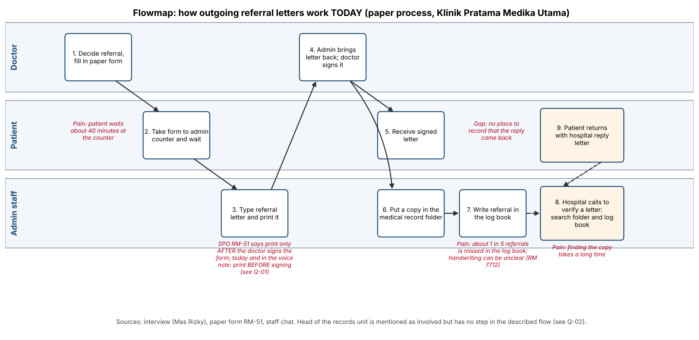
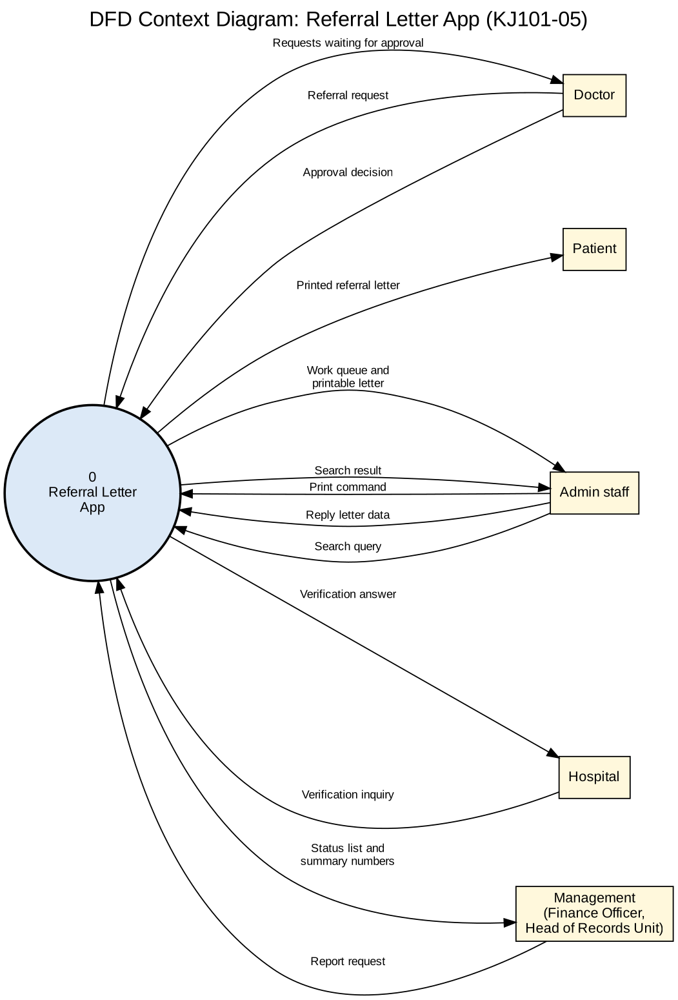
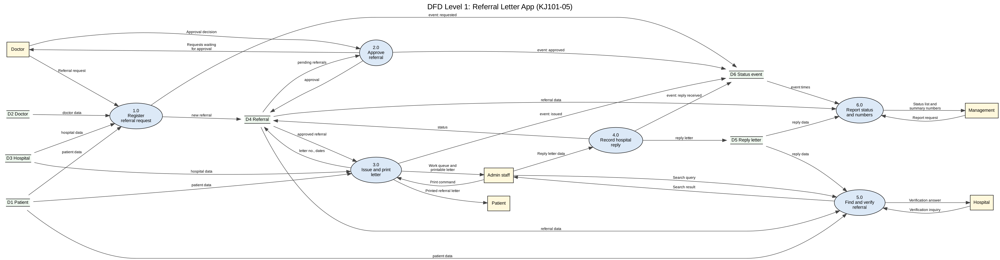
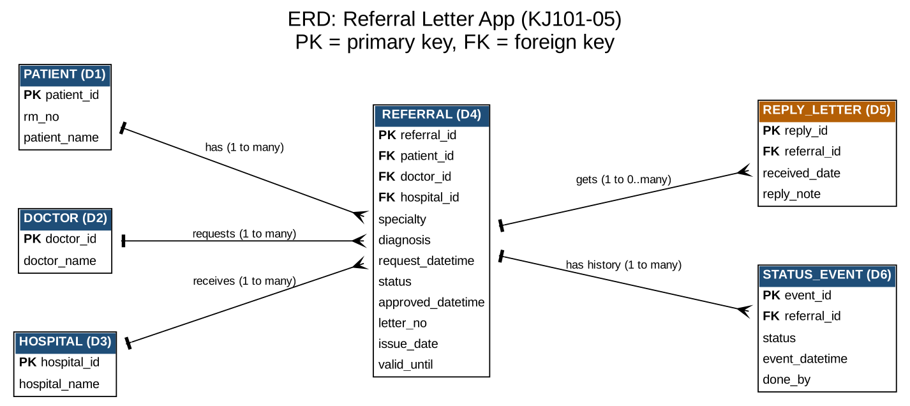

# B. Models

All four models are built only from the case files. Anything extra is marked as an assumption.

## 1. Flowmap: how the work runs today

Source: the interview (Mas Rizky's five stages, which I split into steps 1 to 7), the paper form RM-51 and the staff chat. The extra steps 8 and 9 come from the interview (hospital calls to verify) and the staff chat (Pak Udin's reply letter). The red notes mark the three problems the client named, the missing place for reply letters, and the conflict about print order (Q-01).

## 2. DFD context diagram

## 3. DFD level 1

Data stores: D1 Patient, D2 Doctor, D3 Hospital, D4 Referral, D5 Reply letter, D6 Status event.

## 4. ERD

| Entity | Key | Notes |
|---|---|---|
| PATIENT | patient_id | RM number and name (RM 7712 Wati, 8030 Udin, 6519 Siti A.) |
| DOCTOR | doctor_id | referring doctors (dr. Rina, dr. Bayu) |
| HOSPITAL | hospital_id | destinations (RSUD Kota, RS Karya Bhakti) |
| REFERRAL | referral_id | one row per referral: specialty, diagnosis, status, letter number, issue date, valid until |
| REPLY_LETTER | reply_id | the extra data item from the staff chat |
| STATUS_EVENT | event_id | one row per status change; gives the history and the waiting times |

Relationships: a patient, a doctor and a hospital each have many referrals; a referral has zero or more reply letters and many status events. *(my assumption: one letter per referral, so letter number, issue date and valid until sit in REFERRAL.)*

## How the three fit together
The flowmap shows today's paper steps and where they hurt. Each step becomes a process in the DFD: writing the form becomes 1.0, the doctor's signature becomes 2.0, typing and printing becomes 3.0, the log book and the folder disappear into the data stores, hospital calls become 5.0 and the reply letter becomes 4.0. The new process 6.0 serves the client's wish to see status and numbers.

Each DFD data store is one ERD entity, one to one: D1 PATIENT, D2 DOCTOR, D3 HOSPITAL, D4 REFERRAL, D5 REPLY_LETTER, D6 STATUS_EVENT. Every attribute in the ERD is in the PRD data list, and the other way round.

**Balance check (context vs level 1).** Every flow between an outside entity and the system in the context diagram appears at level 1 with the same name, and level 1 adds no new outside flow:

| Entity | Into the system | Out of the system | Level 1 process |
|---|---|---|---|
| Doctor | Referral request; Approval decision | Requests waiting for approval | 1.0, 2.0 |
| Admin staff | Print command; Reply letter data; Search query | Work queue and printable letter; Search result | 3.0, 4.0, 5.0 |
| Patient | none | Printed referral letter | 3.0 |
| Hospital | Verification inquiry | Verification answer | 5.0 |
| Management | Report request | Status list and summary numbers | 6.0 |

*(my assumption on 5.0: in real life admin takes the hospital's phone call and relays the answer. The DFD shows the information flow to the hospital.)*
